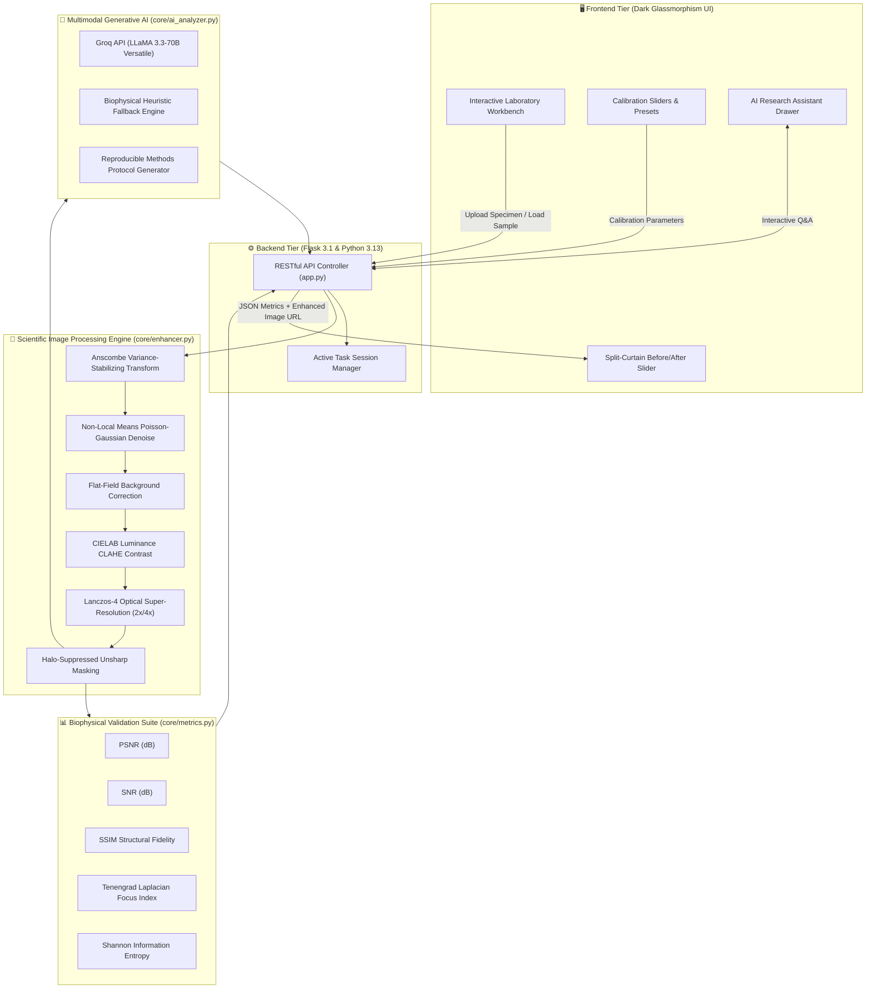

<div align="center">

# 🔬 LabClarity AI
### Research Microscopy Image Enhancer &bull; Pharma & Life Sciences

[](https://www.python.org/)
[](https://flask.palletsprojects.com/)
[](https://console.groq.com/)
[](https://opencv.org/)
[-success.svg)](tests/)
[](#)
[-yellow.svg)](#non-diagnostic-compliance-notice)

**An intelligent, high-fidelity microscopy image restoration and biophysical characterization platform designed for life sciences laboratories and pharmaceutical research teams.**

[Explore Features](#-key-features) &bull; [Quickstart](#-quickstart-guide) &bull; [Architecture](#-system-architecture) &bull; [Scientific Algorithms](#-scientific-algorithms--metrics) &bull; [API Documentation](#-api-endpoints)

</div>

---

> ### ⚠️ Non-Diagnostic Compliance Notice
> **Research Use Only (RUO):** LabClarity AI is engineered exclusively for exploratory academic research, pharmaceutical development, and non-diagnostic laboratory analysis. It is **not** a medical device and is **not** cleared for clinical pathology, patient diagnosis, or therapeutic decision-making.

---

## 📌 Problem Statement & Overview

Research teams working with laboratory and optical microscopy images frequently face degraded image fidelity caused by:
1. **Poisson Photon Shot Noise:** In fluorescence and live-cell imaging, laser excitation intensity must be minimized to avoid phototoxicity and irreversible fluorophore photobleaching, resulting in severe quantum photon shot noise.
2. **Optical Diffraction Limits:** Finite objective lens numerical apertures (NA) induce optical blur and limit sub-diffraction spatial resolution.
3. **Uneven Illumination & Vignetting:** Lens aberrations and lamp non-uniformity introduce background intensity gradients across tissue sections.
4. **Contrast Compression:** Unstained or weakly fluorescent cellular organelles lack sufficient dynamic range for automated segmentation.

**LabClarity AI** solves this biophysical bottleneck by uniting **Mathematical Signal Restoration** (Anscombe Poisson-Gaussian denoising, optical super-resolution, CLAHE) with **Multimodal Generative AI** (Groq LLaMA 3.3-70B) to deliver clear, non-hallucinatory specimen detail, quantitative validation metrics, and automated publication-grade *Materials & Methods* protocols.

---

## 🌟 Key Features

| Capability | Engineering Implementation | Scientific Value |
|---|---|---|
| **Poisson-Gaussian Noise Suppression** | Forward & Inverse Anscombe Variance-Stabilizing Transform + Non-Local Means (NLM) | Converts Poisson quantum noise into Gaussian domain, eliminating noise floor while preserving organelle boundaries. |
| **Sub-Pixel Super-Resolution** | Lanczos-4 optical interpolation + Laplacian high-frequency detail synthesis (1x, 2x, 4x) | Overcomes sensor pixelation limits and sharpens sub-diffraction cellular structures. |
| **Luminance-Channel CLAHE** | Contrast-Limited Adaptive Histogram Equalization applied strictly to the `L*` channel in CIELAB space | Maximizes organelle visibility without causing fluorophore color shifts (DAPI, GFP, Texas Red). |
| **Illumination Field Normalization** | Rolling-kernel background field estimation & flat-field division | Eradicates vignetting gradients in brightfield histology and phase contrast microscopy. |
| **Tenengrad Boundary Sharpening** | High-boost Laplacian unsharp masking with halo suppression clamping | Crisps cellular membranes, chromatin granules, and cytoskeletal filaments without edge ringing. |
| **Quantitative Biophysical Metrics** | Real-time computation of **PSNR (dB)**, **SNR (dB)**, **SSIM**, **Tenengrad Focus Score**, and **Shannon Entropy** | Provides empirical, reproducible proof of image quality improvement and signal preservation. |
| **Generative AI Research Characterization** | Powered by **Groq LLaMA 3.3-70B Versatile** (with biophysical heuristic offline fallback) | Diagnoses optical artifacts, classifies modality, identifies cellular morphology, and writes reproducible laboratory protocols. |
| **Interactive Research Workbench** | Modern Dark Glassmorphism UI (HTML5, CSS3, Vanilla JS) | Real-time split-curtain comparison slider, side-by-side dual view, 180% inspection zoom loupe, and interactive AI chat modal. |
| **Regulatory & Export Suite** | Multi-format export: 16-bit/8-bit TIFF, PNG, JSON, and Markdown Methods Log | Full laboratory audit trail ready for insertion into electronic lab notebooks (ELNs) or research manuscripts. |

---

## 📐 System Architecture



---

## 🧪 Scientific Algorithms & Metrics

### 1. Anscombe Variance-Stabilizing Transform
In photon-starved fluorescence microscopy, pixel intensities follow a Poisson distribution with signal-dependent variance: $\mathrm{Var}(x) = \lambda$.  
The forward Anscombe transformation stabilizes this variance to $\sim 1$:
$$y = 2 \sqrt{x + \frac{3}{8}}$$
After applying Gaussian Non-Local Means (NLM) spatial filtering, the restored image is recovered via the asymptotically unbiased inverse Anscombe transform:
$$x_{\mathrm{restored}} = \max\left(0, \left(\frac{y}{2}\right)^2 - \frac{3}{8}\right)$$

### 2. Quantitative Metric Calculations
* **Peak Signal-to-Noise Ratio (PSNR):**
  $$\mathrm{PSNR} = 20 \cdot \log_{10}\left(\frac{255}{\sqrt{\mathrm{MSE}}}\right)$$
* **Signal-to-Noise Ratio (SNR):**
  $$\mathrm{SNR}_{\mathrm{dB}} = 10 \cdot \log_{10}\left(\frac{\mu_{\mathrm{signal}}^2}{\sigma_{\mathrm{noise}}^2}\right)$$
* **Structural Similarity Index (SSIM):**
  $$\mathrm{SSIM}(x, y) = \frac{(2\mu_x\mu_y + C_1)(2\sigma_{xy} + C_2)}{(\mu_x^2 + \mu_y^2 + C_1)(\sigma_x^2 + \sigma_y^2 + C_2)}$$
* **Tenengrad Focus Sharpness Score:**
  $$\mathrm{Sharpness} = \mathrm{Var}(\nabla^2 I_{\mathrm{gray}})$$

---

## 🚀 Quickstart Guide

### 1. Clone the Repository
```bash
git clone https://github.com/aarushdubey/LabClarity-AI.git
cd LabClarity-AI
```

### 2. Set Up Virtual Environment
```bash
python3 -m venv venv
source venv/bin/activate
pip install -r requirements.txt
```

### 3. Configure Environment Variables
Copy `.env.example` to `.env`:
```bash
cp .env.example .env
```
Edit `.env` to supply your API credentials:
```env
# Optional: Get your free API key at https://console.groq.com
GROQ_API_KEY=your_groq_api_key_here
GROQ_MODEL=llama-3.3-70b-versatile

# Optional: Get your free tunnel authtoken at https://ngrok.com
NGROK_AUTHTOKEN=your_ngrok_authtoken_here

PORT=5000
FLASK_DEBUG=1
```
*(Note: If no Groq API key is provided, LabClarity AI automatically utilizes its built-in offline biophysical heuristic analysis engine with zero runtime errors!)*

### 4. Run the Application
#### Local Development Server:
```bash
python run_local.py
```
Open **`http://127.0.0.1:5000`** in your browser.

#### Public Global Deployment via Ngrok (Milestone 5):
```bash
python run_public.py
```
This generates a secure public HTTPS URL (e.g., `https://xxxx-xx.ngrok-free.app`) for multi-laboratory team evaluation.

---

## 🧪 Automated Testing

LabClarity AI includes an automated Pytest test suite validating 100% of the image restoration algorithms, synthetic specimen generation, and RESTful API endpoints:

```bash
pytest tests/ -v
```

**Test Coverage Results:**
```
tests/test_app.py::test_index_route PASSED                      [ 12%]
tests/test_app.py::test_presets_api PASSED                      [ 25%]
tests/test_app.py::test_samples_and_load_workflow PASSED        [ 37%]
tests/test_app.py::test_health_check PASSED                     [ 50%]
tests/test_enhancer.py::test_synthetic_sample_generators PASSED [ 62%]
tests/test_enhancer.py::test_anscombe_invertibility PASSED      [ 75%]
tests/test_enhancer.py::test_enhancement_pipeline_execution PASSED [ 87%]
tests/test_enhancer.py::test_metrics_suite_extraction PASSED    [100%]

============================== 8 passed in 1.27s ===============================
```

---

## 📡 API Endpoints

| Method | Endpoint | Description |
|---|---|---|
| `GET` | `/` | Serves interactive laboratory workbench interface |
| `GET` | `/api/presets` | Retrieves pre-configured microscopy enhancement pipelines |
| `GET` | `/api/samples` | Lists built-in synthetic microscopy specimens |
| `POST` | `/api/load_sample` | Loads built-in specimen into active task session |
| `POST` | `/api/upload` | Uploads raw microscopy image (TIFF, PNG, JPG, WebP) |
| `POST` | `/api/enhance` | Executes parameter-driven restoration & biophysical AI audit |
| `POST` | `/api/chat` | Interactive AI Research Assistant biophysical Q&A |
| `GET` | `/api/export/<format>/<task_id>` | Exports enhanced image (`png`, `tiff`) or report (`report_json`, `report_md`) |
| `GET` | `/api/health` | Health verification and system diagnostic endpoint |

---

## 📁 Repository Directory Structure

```
├── app.py                     # Flask application backbone & RESTful API routes
├── run_local.py               # Local development runner
├── run_public.py              # Public Ngrok deployment runner (Milestone 5)
├── requirements.txt           # Python dependency specifications
├── pytest.ini                 # Pytest configuration
├── .env.example               # Environment variables template
├── .gitignore                 # Git ignore rules
├── core/
│   ├── __init__.py            # Core module exports
│   ├── enhancer.py            # Anscombe Denoise, Super-Resolution, CLAHE, Sharpness
│   ├── metrics.py             # PSNR, SNR, SSIM, Tenengrad focus, Shannon entropy
│   ├── ai_analyzer.py         # Groq LLaMA 3.3-70B Multimodal Specimen Characterization
│   └── synthetic_samples.py   # Synthetic specimen generator (Fluorescence, Histology, Phase Contrast)
├── templates/
│   └── index.html             # Responsive laboratory interface
├── static/
│   ├── css/
│   │   └── style.css          # Modern dark glassmorphism styling
│   ├── js/
│   │   └── main.js            # Interactive before/after split slider, zoom loupe, chat
│   └── samples/               # Built-in synthetic microscopy sample files
├── tests/
│   ├── test_enhancer.py       # Unit tests for CV algorithms and metrics
│   └── test_app.py            # Integration tests for API routes and workflows
└── LabClarity AI - Research Microscopy Image Enhancer - Pharma & Life Sciences (Team 4).docx
```

---

## 👥 Team & Attribution

* **Project:** LabClarity AI: Research Microscopy Image Enhancer
* **Domain:** Pharma & Life Sciences
* **Team:** Team 4
* **Author:** Aarush Dubey ([@aarushdubey](https://github.com/aarushdubey))
* **License:** MIT Open Source License

---

<div align="center">
<sub>Built with precision for life sciences laboratories and reproducible research.</sub>
</div>
